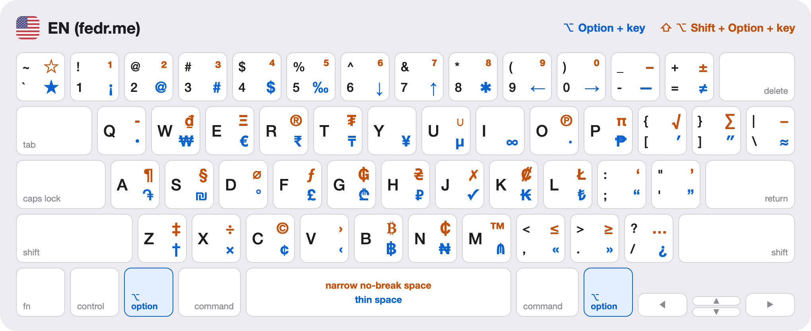
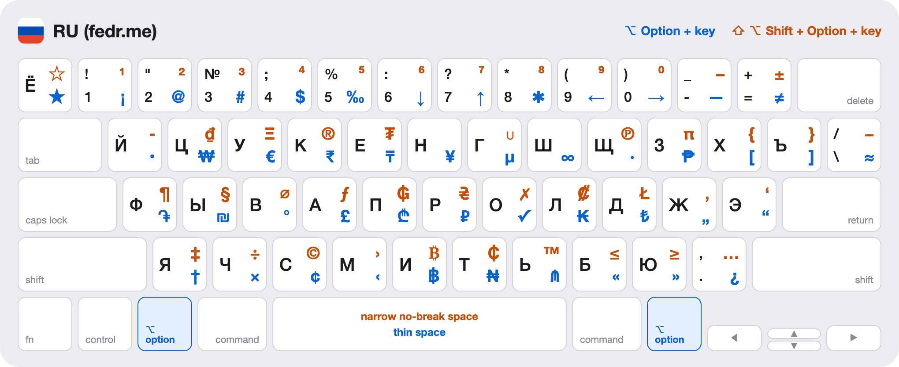
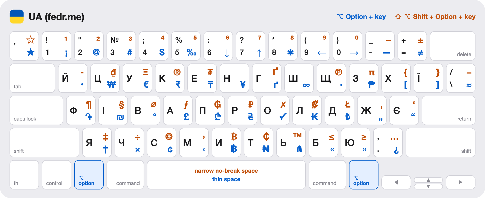
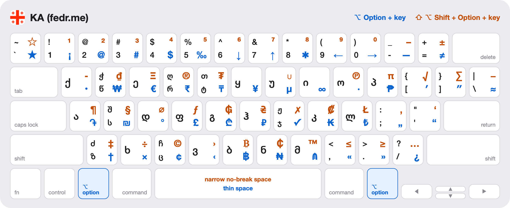

# fedr.me keyboard layouts

**English** · [Русский](README.ru.md)

Four keyboard layouts for macOS — English, Russian, Ukrainian and Georgian — that share one Option layer with typographic quotes and dashes, currency signs, math symbols, arrows and superscripts.

<picture>
  <source media="(prefers-color-scheme: dark)" srcset="images/en-dark.png">
  
</picture>

- **Letters stay where they are.** The base and Shift layers are the usual ones: US QWERTY, Russian and Ukrainian ЙЦУКЕН (PC variant), Georgian QWERTY. Only the Option layers are different.
- **The same symbol sits on the same key in every layout**, so `—`, `«»`, `€` or `→` are typed the same way no matter which language is active. The few exceptions are listed [below](#differences-between-the-layouts).
- **Easy to remember.** `€` is on <kbd>E</kbd>, `₸` on <kbd>T</kbd>, `₾` on <kbd>G</kbd>, `©` on <kbd>C</kbd>, `®` on <kbd>R</kbd>, `™` on <kbd>M</kbd>, `π` on <kbd>P</kbd>, `∞` on <kbd>I</kbd>, `×` and `÷` on <kbd>X</kbd>, `«` `»` and `≤` `≥` on the <kbd>&lt;</kbd> <kbd>&gt;</kbd> keys, `—` and `–` on <kbd>-</kbd>, `≠` and `±` on <kbd>=</kbd>, superscript digits on the digits.
- **No dead keys.** Every combination types its symbol right away. The flip side: accented letters such as `é` or `ü` are not on the Option layer; hold the letter key to get them from the macOS accent popup.
- **`@`, `#`, `$`, `[`, `]`, `{`, `}` without switching to English** in the Russian and Ukrainian layouts.
- **Shortcuts work in every layout**: with <kbd>⌘</kbd> held, all four layouts behave as QWERTY.

## Layouts

In the pictures the blue symbol is typed with <kbd>⌥ Option</kbd> + key and the orange one with <kbd>⇧ Shift</kbd> + <kbd>⌥ Option</kbd> + key. <kbd>⌥</kbd> + <kbd>Space</kbd> types a thin space and <kbd>⇧</kbd> + <kbd>⌥</kbd> + <kbd>Space</kbd> a narrow no-break space.

### EN (fedr.me) — English

Shown at the top of the page. The base layer is the standard US QWERTY.

### RU (fedr.me) — Russian

ЙЦУКЕН in the PC variant: `Ё` on the <kbd>`</kbd> key, `№` on <kbd>⇧</kbd> + <kbd>3</kbd>, `.` and `,` on the <kbd>/</kbd> key.

<picture>
  <source media="(prefers-color-scheme: dark)" srcset="images/ru-dark.png">
  
</picture>

### UA (fedr.me) — Ukrainian

Ukrainian ЙЦУКЕН with the apostrophe `ʼ` on the <kbd>`</kbd> key. `ґ` and `Ґ` are typed with <kbd>⌥</kbd> + <kbd>U</kbd> and <kbd>⇧</kbd> + <kbd>⌥</kbd> + <kbd>U</kbd>.

<picture>
  <source media="(prefers-color-scheme: dark)" srcset="images/ua-dark.png">
  
</picture>

### KA (fedr.me) — Georgian

Georgian QWERTY: seven more letters (`ჭ` `ღ` `თ` `შ` `ჟ` `ძ` `ჩ`) are typed with <kbd>⇧ Shift</kbd>.

<picture>
  <source media="(prefers-color-scheme: dark)" srcset="images/ka-dark.png">
  
</picture>

The pictures show an ANSI keyboard. The additional key of ISO keyboards types `\` and `|` in EN and KA, `\` and `/` in RU, `ґ` and `Ґ` in UA, and has no Option symbols.

## Installation

All four layouts live in one bundle, `fedr.me keyboard.bundle`. You can install the bundle and then enable only the layouts you need.

1. **Download the repository**: [Download ZIP](https://github.com/fedorananin/keyboard-layouts/archive/refs/heads/main.zip) and unpack it.
2. **Copy the bundle.** In Finder choose **Go → Go to Folder…** (<kbd>⇧</kbd><kbd>⌘</kbd><kbd>G</kbd>), enter `~/Library/Keyboard Layouts` and copy `fedr.me keyboard.bundle` into that folder.
   To install the layouts for every user of the Mac, use `/Library/Keyboard Layouts` instead (an administrator password is required).
3. **Log out and log in again** (or restart the Mac) so that macOS picks up the new layouts.
4. **Enable the layouts.** Open **System Settings → Keyboard → Text Input → Input Sources → Edit…**, click **+**, choose a language (English, Russian, Ukrainian or Georgian), select the layout with `(fedr.me)` in its name and click **Add**. If a layout is not listed under its language, look in **Others** at the end of the language list.
   On macOS 12 and earlier: **System Preferences → Keyboard → Input Sources**.
5. **Remove the standard layouts** you no longer need with the **−** button in the same window. macOS keeps at least one built-in Latin layout (ABC, U.S. and so on) in the list, so one of them stays next to the new ones.

The same from Terminal:

```bash
git clone https://github.com/fedorananin/keyboard-layouts.git
```

```bash
mkdir -p ~/Library/Keyboard\ Layouts && cp -R "keyboard-layouts/fedr.me keyboard.bundle" ~/Library/Keyboard\ Layouts/
```

Then log out, log in and enable the layouts as described in step 4.

### Updating

Replace `fedr.me keyboard.bundle` in `~/Library/Keyboard Layouts` with the new version and log out and in again. The enabled layouts stay enabled.

### Removing

Remove the layouts in **System Settings → Keyboard → Text Input → Input Sources → Edit…**, delete `fedr.me keyboard.bundle` from `~/Library/Keyboard Layouts` and log out and in again.

## All symbols

<kbd>⌥</kbd> is Option, <kbd>⇧</kbd> is Shift. Keys are named by their US QWERTY labels. When a symbol is not on the same key in all four layouts, the layouts are listed next to each combination.

<!-- BEGIN SYMBOLS -->
### Quotation marks

| Symbol | Name | Keys | Unicode |
| :---: | --- | --- | --- |
| « | Left guillemet | <kbd>⌥</kbd><kbd>,</kbd> | `U+00AB` |
| » | Right guillemet | <kbd>⌥</kbd><kbd>.</kbd> | `U+00BB` |
| „ | Low double quotation mark | <kbd>⌥</kbd><kbd>;</kbd> — RU, UA, KA | `U+201E` |
| “ | Left double quotation mark | <kbd>⌥</kbd><kbd>;</kbd> — EN<br><kbd>⌥</kbd><kbd>&#39;</kbd> — RU, UA, KA | `U+201C` |
| ” | Right double quotation mark | <kbd>⌥</kbd><kbd>&#39;</kbd> — EN | `U+201D` |
| ‚ | Low single quotation mark | <kbd>⇧</kbd><kbd>⌥</kbd><kbd>;</kbd> — RU, UA, KA | `U+201A` |
| ‘ | Left single quotation mark | <kbd>⇧</kbd><kbd>⌥</kbd><kbd>;</kbd> — EN<br><kbd>⇧</kbd><kbd>⌥</kbd><kbd>&#39;</kbd> — RU, UA, KA | `U+2018` |
| ’ | Right single quotation mark, apostrophe | <kbd>⇧</kbd><kbd>⌥</kbd><kbd>&#39;</kbd> — EN | `U+2019` |
| ‹ | Single left guillemet | <kbd>⌥</kbd><kbd>V</kbd> | `U+2039` |
| › | Single right guillemet | <kbd>⇧</kbd><kbd>⌥</kbd><kbd>V</kbd> | `U+203A` |

### Dashes, punctuation and spaces

| Symbol | Name | Keys | Unicode |
| :---: | --- | --- | --- |
| — | Em dash | <kbd>⌥</kbd><kbd>-</kbd> | `U+2014` |
| – | En dash | <kbd>⇧</kbd><kbd>⌥</kbd><kbd>-</kbd> | `U+2013` |
| … | Ellipsis | <kbd>⇧</kbd><kbd>⌥</kbd><kbd>/</kbd> | `U+2026` |
| • | Bullet | <kbd>⌥</kbd><kbd>Q</kbd> | `U+2022` |
| ⁃ | Hyphen bullet | <kbd>⇧</kbd><kbd>⌥</kbd><kbd>Q</kbd> | `U+2043` |
| · | Middle dot | <kbd>⌥</kbd><kbd>O</kbd> | `U+00B7` |
| ¡ | Inverted exclamation mark | <kbd>⌥</kbd><kbd>1</kbd> | `U+00A1` |
| ¿ | Inverted question mark | <kbd>⌥</kbd><kbd>/</kbd> | `U+00BF` |
| § | Section sign | <kbd>⇧</kbd><kbd>⌥</kbd><kbd>S</kbd> | `U+00A7` |
| ¶ | Pilcrow | <kbd>⇧</kbd><kbd>⌥</kbd><kbd>A</kbd> | `U+00B6` |
| † | Dagger | <kbd>⌥</kbd><kbd>Z</kbd> | `U+2020` |
| ‡ | Double dagger | <kbd>⇧</kbd><kbd>⌥</kbd><kbd>Z</kbd> | `U+2021` |
|  | Thin space | <kbd>⌥</kbd><kbd>Space</kbd> | `U+2009` |
|  | Narrow no-break space | <kbd>⇧</kbd><kbd>⌥</kbd><kbd>Space</kbd> | `U+202F` |

### Currencies

| Symbol | Name | Keys | Unicode |
| :---: | --- | --- | --- |
| &#36; | Dollar | <kbd>⌥</kbd><kbd>4</kbd> | `U+0024` |
| € | Euro | <kbd>⌥</kbd><kbd>E</kbd> | `U+20AC` |
| £ | Pound sterling | <kbd>⌥</kbd><kbd>F</kbd> | `U+00A3` |
| ¥ | Yen, yuan | <kbd>⌥</kbd><kbd>Y</kbd> | `U+00A5` |
| ¢ | Cent | <kbd>⌥</kbd><kbd>C</kbd> | `U+00A2` |
| ₽ | Russian ruble | <kbd>⌥</kbd><kbd>H</kbd> — EN, RU, KA<br><kbd>⇧</kbd><kbd>⌥</kbd><kbd>H</kbd> — UA | `U+20BD` |
| ₴ | Ukrainian hryvnia | <kbd>⇧</kbd><kbd>⌥</kbd><kbd>H</kbd> — EN, RU, KA<br><kbd>⌥</kbd><kbd>H</kbd> — UA | `U+20B4` |
| ₾ | Georgian lari | <kbd>⌥</kbd><kbd>G</kbd> | `U+20BE` |
| ֏ | Armenian dram | <kbd>⌥</kbd><kbd>A</kbd> | `U+058F` |
| ₸ | Kazakhstani tenge | <kbd>⌥</kbd><kbd>T</kbd> | `U+20B8` |
| ₼ | Azerbaijani manat | <kbd>⌥</kbd><kbd>M</kbd> | `U+20BC` |
| ₺ | Turkish lira | <kbd>⌥</kbd><kbd>L</kbd> | `U+20BA` |
| ₪ | Israeli new shekel | <kbd>⌥</kbd><kbd>S</kbd> | `U+20AA` |
| ₹ | Indian rupee | <kbd>⌥</kbd><kbd>R</kbd> | `U+20B9` |
| ₩ | Korean won | <kbd>⌥</kbd><kbd>W</kbd> | `U+20A9` |
| ₱ | Philippine peso | <kbd>⌥</kbd><kbd>P</kbd> | `U+20B1` |
| ฿ | Thai baht | <kbd>⌥</kbd><kbd>B</kbd> | `U+0E3F` |
| ₫ | Vietnamese dong | <kbd>⇧</kbd><kbd>⌥</kbd><kbd>W</kbd> | `U+20AB` |
| ₭ | Lao kip | <kbd>⌥</kbd><kbd>K</kbd> | `U+20AD` |
| ₮ | Mongolian tugrik | <kbd>⇧</kbd><kbd>⌥</kbd><kbd>T</kbd> | `U+20AE` |
| ₦ | Nigerian naira | <kbd>⌥</kbd><kbd>N</kbd> | `U+20A6` |
| ₵ | Ghanaian cedi | <kbd>⇧</kbd><kbd>⌥</kbd><kbd>N</kbd> | `U+20B5` |
| ₲ | Paraguayan guarani | <kbd>⇧</kbd><kbd>⌥</kbd><kbd>G</kbd> | `U+20B2` |
| ₡ | Colón | <kbd>⇧</kbd><kbd>⌥</kbd><kbd>K</kbd> | `U+20A1` |
| ƒ | Florin; function sign | <kbd>⇧</kbd><kbd>⌥</kbd><kbd>F</kbd> | `U+0192` |
| ₿ | Bitcoin | <kbd>⇧</kbd><kbd>⌥</kbd><kbd>B</kbd> | `U+20BF` |
| Ξ | Greek capital Xi (Ethereum) | <kbd>⇧</kbd><kbd>⌥</kbd><kbd>E</kbd> | `U+039E` |
| Ł | L with stroke (Litecoin) | <kbd>⇧</kbd><kbd>⌥</kbd><kbd>L</kbd> | `U+0141` |

### Math and units

| Symbol | Name | Keys | Unicode |
| :---: | --- | --- | --- |
| ≠ | Not equal to | <kbd>⌥</kbd><kbd>=</kbd> | `U+2260` |
| ≈ | Almost equal to | <kbd>⌥</kbd><kbd>&#92;</kbd> | `U+2248` |
| ± | Plus-minus | <kbd>⇧</kbd><kbd>⌥</kbd><kbd>=</kbd> | `U+00B1` |
| − | Minus | <kbd>⇧</kbd><kbd>⌥</kbd><kbd>&#92;</kbd> | `U+2212` |
| × | Multiplication sign | <kbd>⌥</kbd><kbd>X</kbd> | `U+00D7` |
| ÷ | Division sign | <kbd>⇧</kbd><kbd>⌥</kbd><kbd>X</kbd> | `U+00F7` |
| ≤ | Less than or equal to | <kbd>⇧</kbd><kbd>⌥</kbd><kbd>,</kbd> | `U+2264` |
| ≥ | Greater than or equal to | <kbd>⇧</kbd><kbd>⌥</kbd><kbd>.</kbd> | `U+2265` |
| ∞ | Infinity | <kbd>⌥</kbd><kbd>I</kbd> | `U+221E` |
| √ | Square root | <kbd>⇧</kbd><kbd>⌥</kbd><kbd>&#91;</kbd> — EN, KA | `U+221A` |
| ∑ | Summation | <kbd>⇧</kbd><kbd>⌥</kbd><kbd>&#93;</kbd> — EN, KA | `U+2211` |
| ∪ | Union | <kbd>⇧</kbd><kbd>⌥</kbd><kbd>U</kbd> — EN, RU, KA | `U+222A` |
| π | Pi | <kbd>⇧</kbd><kbd>⌥</kbd><kbd>P</kbd> | `U+03C0` |
| µ | Micro sign | <kbd>⌥</kbd><kbd>U</kbd> — EN, RU, KA | `U+00B5` |
| ° | Degree | <kbd>⌥</kbd><kbd>D</kbd> | `U+00B0` |
| ′ | Prime (minutes, feet) | <kbd>⌥</kbd><kbd>&#91;</kbd> — EN, KA | `U+2032` |
| ″ | Double prime (seconds, inches) | <kbd>⌥</kbd><kbd>&#93;</kbd> — EN, KA | `U+2033` |
| ‰ | Per mille | <kbd>⌥</kbd><kbd>5</kbd> | `U+2030` |
| ⌀ | Diameter | <kbd>⇧</kbd><kbd>⌥</kbd><kbd>D</kbd> | `U+2300` |
| ¹ | Superscript 1 | <kbd>⇧</kbd><kbd>⌥</kbd><kbd>1</kbd> | `U+00B9` |
| ² | Superscript 2 | <kbd>⇧</kbd><kbd>⌥</kbd><kbd>2</kbd> | `U+00B2` |
| ³ | Superscript 3 | <kbd>⇧</kbd><kbd>⌥</kbd><kbd>3</kbd> | `U+00B3` |
| ⁴ | Superscript 4 | <kbd>⇧</kbd><kbd>⌥</kbd><kbd>4</kbd> | `U+2074` |
| ⁵ | Superscript 5 | <kbd>⇧</kbd><kbd>⌥</kbd><kbd>5</kbd> | `U+2075` |
| ⁶ | Superscript 6 | <kbd>⇧</kbd><kbd>⌥</kbd><kbd>6</kbd> | `U+2076` |
| ⁷ | Superscript 7 | <kbd>⇧</kbd><kbd>⌥</kbd><kbd>7</kbd> | `U+2077` |
| ⁸ | Superscript 8 | <kbd>⇧</kbd><kbd>⌥</kbd><kbd>8</kbd> | `U+2078` |
| ⁹ | Superscript 9 | <kbd>⇧</kbd><kbd>⌥</kbd><kbd>9</kbd> | `U+2079` |
| ⁰ | Superscript 0 | <kbd>⇧</kbd><kbd>⌥</kbd><kbd>0</kbd> | `U+2070` |

### Arrows and marks

| Symbol | Name | Keys | Unicode |
| :---: | --- | --- | --- |
| ← | Left arrow | <kbd>⌥</kbd><kbd>9</kbd> | `U+2190` |
| → | Right arrow | <kbd>⌥</kbd><kbd>0</kbd> | `U+2192` |
| ↑ | Up arrow | <kbd>⌥</kbd><kbd>7</kbd> | `U+2191` |
| ↓ | Down arrow | <kbd>⌥</kbd><kbd>6</kbd> | `U+2193` |
| ✓ | Check mark | <kbd>⌥</kbd><kbd>J</kbd> | `U+2713` |
| ✗ | Ballot X | <kbd>⇧</kbd><kbd>⌥</kbd><kbd>J</kbd> | `U+2717` |
| ★ | Black star | <kbd>⌥</kbd><kbd>&#96;</kbd> | `U+2605` |
| ☆ | White star | <kbd>⇧</kbd><kbd>⌥</kbd><kbd>&#96;</kbd> | `U+2606` |
| ✱ | Heavy asterisk | <kbd>⌥</kbd><kbd>8</kbd> | `U+2731` |

### Legal signs

| Symbol | Name | Keys | Unicode |
| :---: | --- | --- | --- |
| © | Copyright | <kbd>⇧</kbd><kbd>⌥</kbd><kbd>C</kbd> | `U+00A9` |
| ® | Registered trademark | <kbd>⇧</kbd><kbd>⌥</kbd><kbd>R</kbd> | `U+00AE` |
| ™ | Trademark | <kbd>⇧</kbd><kbd>⌥</kbd><kbd>M</kbd> | `U+2122` |
| ℗ | Sound recording copyright | <kbd>⇧</kbd><kbd>⌥</kbd><kbd>O</kbd> | `U+2117` |

### ASCII symbols and letters

| Symbol | Name | Keys | Unicode |
| :---: | --- | --- | --- |
| &#64; | At sign | <kbd>⌥</kbd><kbd>2</kbd> | `U+0040` |
| &#35; | Number sign | <kbd>⌥</kbd><kbd>3</kbd> | `U+0023` |
| &#91; | Left square bracket | <kbd>⌥</kbd><kbd>&#91;</kbd> — RU, UA | `U+005B` |
| &#93; | Right square bracket | <kbd>⌥</kbd><kbd>&#93;</kbd> — RU, UA | `U+005D` |
| &#123; | Left curly bracket | <kbd>⇧</kbd><kbd>⌥</kbd><kbd>&#91;</kbd> — RU, UA | `U+007B` |
| &#125; | Right curly bracket | <kbd>⇧</kbd><kbd>⌥</kbd><kbd>&#93;</kbd> — RU, UA | `U+007D` |
| ґ | Ukrainian letter ґ | <kbd>⌥</kbd><kbd>U</kbd> — UA | `U+0491` |
| Ґ | Ukrainian letter Ґ | <kbd>⇧</kbd><kbd>⌥</kbd><kbd>U</kbd> — UA | `U+0490` |
<!-- END SYMBOLS -->

## Differences between the layouts

The Option layers are identical except for these keys.

<!-- BEGIN DIFFERENCES -->
| Keys | EN | RU | UA | KA |
| --- | :---: | :---: | :---: | :---: |
| <kbd>⌥</kbd><kbd>U</kbd> | µ | µ | ґ | µ |
| <kbd>⇧</kbd><kbd>⌥</kbd><kbd>U</kbd> | ∪ | ∪ | Ґ | ∪ |
| <kbd>⌥</kbd><kbd>&#91;</kbd> | ′ | &#91; | &#91; | ′ |
| <kbd>⇧</kbd><kbd>⌥</kbd><kbd>&#91;</kbd> | √ | &#123; | &#123; | √ |
| <kbd>⌥</kbd><kbd>&#93;</kbd> | ″ | &#93; | &#93; | ″ |
| <kbd>⇧</kbd><kbd>⌥</kbd><kbd>&#93;</kbd> | ∑ | &#125; | &#125; | ∑ |
| <kbd>⌥</kbd><kbd>H</kbd> | ₽ | ₽ | ₴ | ₽ |
| <kbd>⇧</kbd><kbd>⌥</kbd><kbd>H</kbd> | ₴ | ₴ | ₽ | ₴ |
| <kbd>⌥</kbd><kbd>;</kbd> | “ | „ | „ | „ |
| <kbd>⇧</kbd><kbd>⌥</kbd><kbd>;</kbd> | ‘ | ‚ | ‚ | ‚ |
| <kbd>⌥</kbd><kbd>&#39;</kbd> | ” | “ | “ | “ |
| <kbd>⇧</kbd><kbd>⌥</kbd><kbd>&#39;</kbd> | ’ | ‘ | ‘ | ‘ |
<!-- END DIFFERENCES -->

In short:

- **Quotation marks.** EN has the English pairs `“ ”` and `‘ ’`; the other three have `„ “` and `‚ ‘`. The guillemets `« »` and `‹ ›` are the same everywhere.
- **Brackets.** In RU and UA the bracket keys are taken by letters, so `[ ]` and `{ }` moved to the Option layers. EN and KA have `′ ″` and `√ ∑` there.
- **Ukrainian.** `ґ` and `Ґ` replace `µ` and `∪`, and the hryvnia sign `₴` swaps places with the ruble sign `₽`.

<kbd>⇧</kbd> + <kbd>⌥</kbd> + <kbd>Y</kbd> and <kbd>⇧</kbd> + <kbd>⌥</kbd> + <kbd>I</kbd> are free in all layouts.

## Repository contents

| Path | What it is |
| --- | --- |
| `fedr.me keyboard.bundle` | The bundle to install: four `.keylayout` files with their icons |
| `icons` | Source PNG files of the layout icons |
| `images` | Pictures of the layouts for this page, light and dark |
| `tools/generate.py` | Script that draws the pictures and builds the symbol tables from the `.keylayout` files |

## Editing the layouts

The layouts are made with [Ukelele](https://software.sil.org/ukelele/): open `fedr.me keyboard.bundle` in it, change what you need and save. A `.keylayout` file is plain XML, so a text editor works too.

After changing a layout, refresh the pictures and the tables on this page:

```bash
python3 tools/generate.py
```

The script uses only the Python standard library and renders the pictures with headless Google Chrome.

## License

[MIT](LICENSE)
